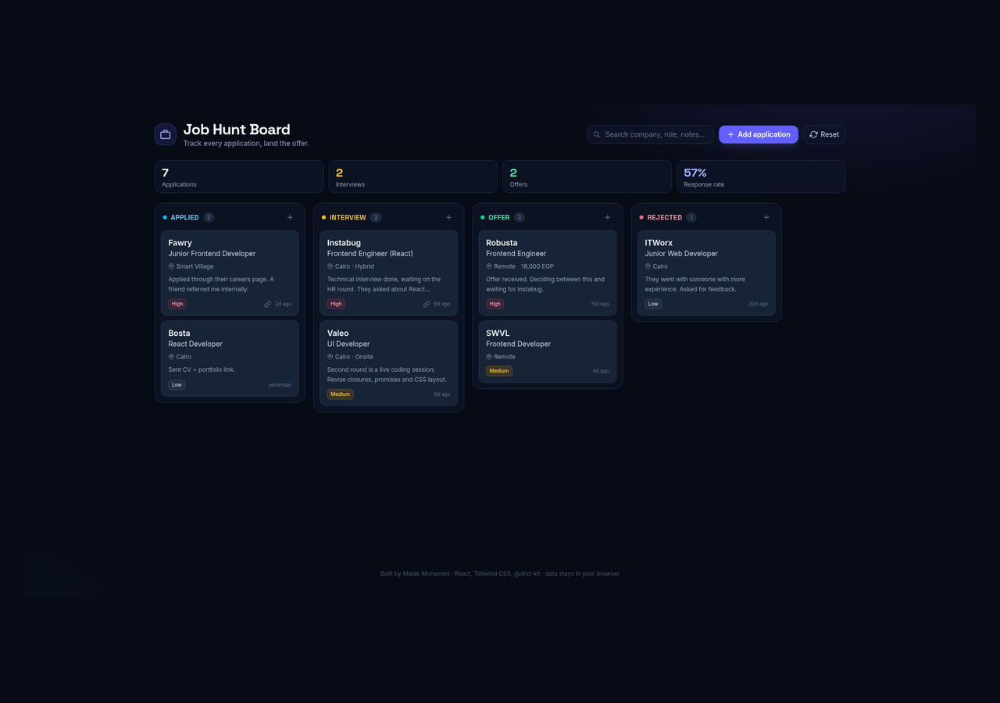

# 💼 Job Hunt Board

A kanban board for the job hunt. Drag applications between Applied, Interview, Offer and Rejected, keep notes, links and priorities, and watch your pipeline stats update live.



**Live demo:** https://malakmo7amed309.github.io/job-hunt-board/

## Standout feature

Real drag and drop between pipeline stages (keyboard accessible, powered by @dnd-kit) plus live pipeline analytics: total applications, interviews, offers and response rate recalculate with every move.

## What it does

- Drag cards between Applied / Interview / Offer / Rejected, or reorder within a column.
- Add, edit and delete applications with company, role, location, salary, job link, priority and notes.
- Instant search across companies and roles.
- Pipeline stats bar: applications, interviews, offers, response rate.
- Everything persists in the browser via localStorage; seeds with realistic demo data and offers a one-click reset.
- Fully responsive, no backend needed.

## Stack

- React + Vite
- Tailwind CSS v4
- @dnd-kit for drag and drop
- localStorage for persistence
- Space Grotesk + Inter type, dark dashboard design

## Run locally

```bash
npm install
npm run dev
```

The production build is a single self-contained `docs/index.html`, deployed to GitHub Pages from the `docs/` folder.
